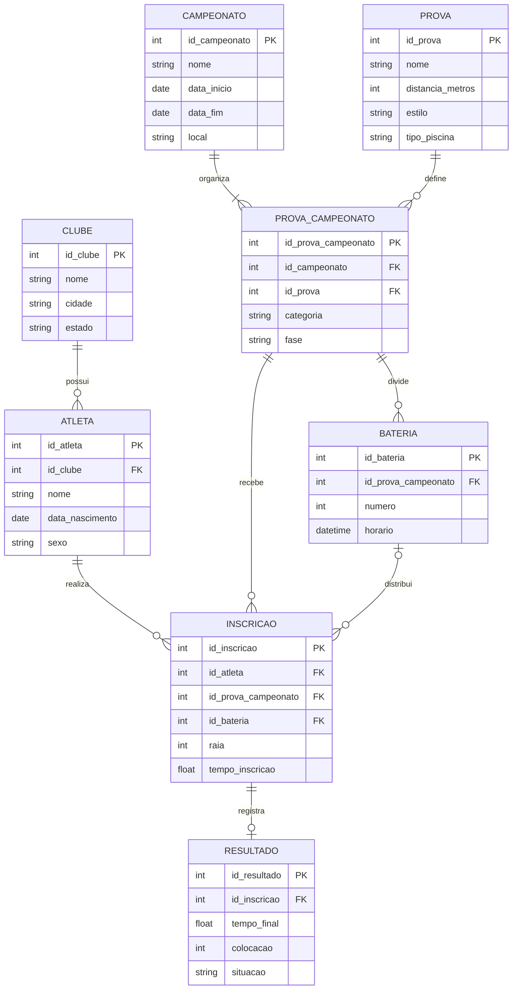
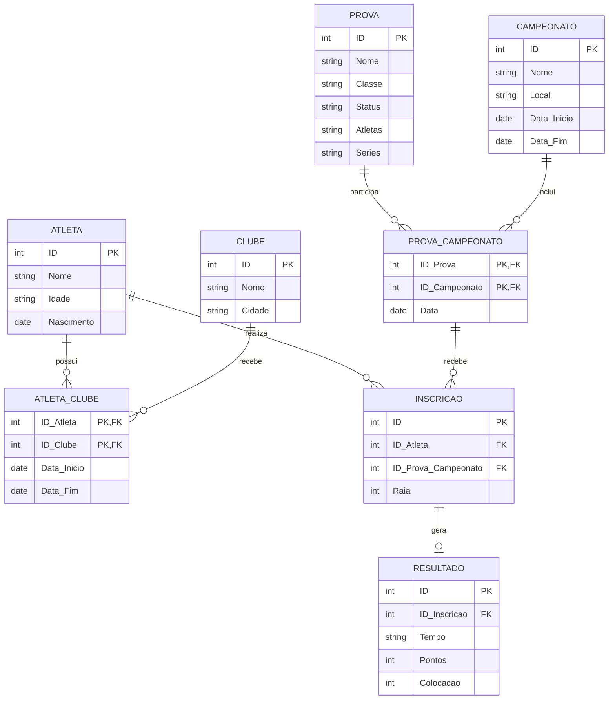
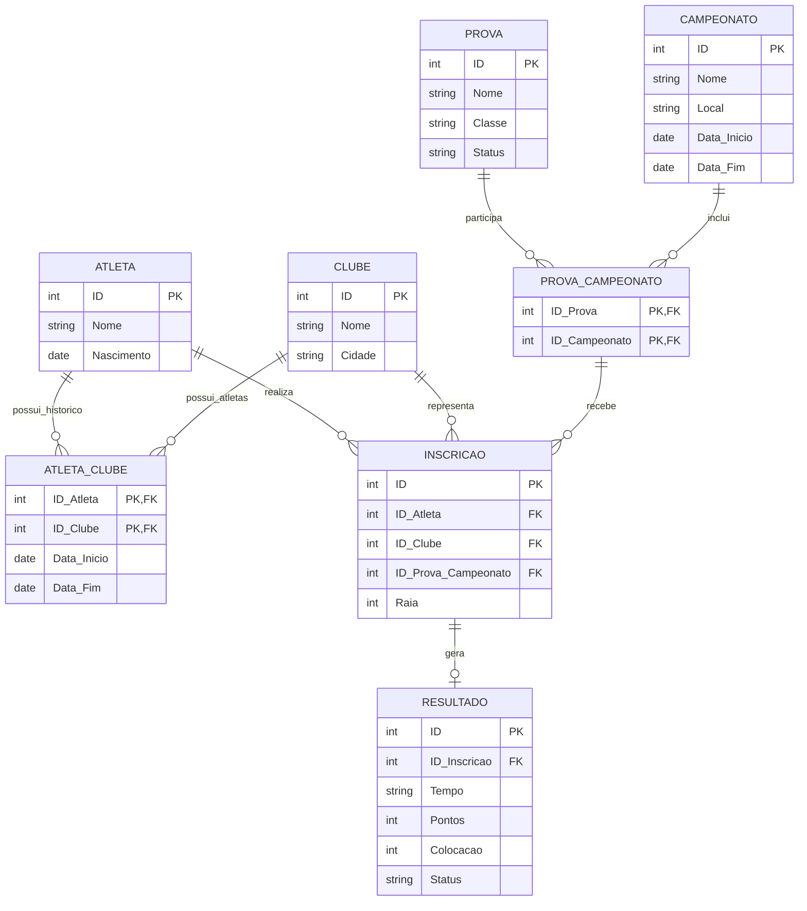

### Script 1:
Como seria o modelo entidade relacionamento de um sistema de provas de natação?
Preciso de uma base pra poder analisar jm site e aprender engenharia reversa

Resposta da IA:
| Entidade | O que representa |
|---|---|
| `ATLETA` | Pessoas que participam das provas. |
| `CLUBE` | Clubes ou equipes aos quais os atletas pertencem. |
| `CAMPEONATO` | Competições organizadas em datas específicas. |
| `PROVA` | Modalidades competitivas, como 100 m livre. |
| `PROVA_CAMPEONATO` | A realização de uma prova dentro de um campeonato específico. |
| `INSCRICAO` | A participação de um atleta em uma prova de um campeonato. |
| `BATERIA` | Uma divisão da prova em grupos de atletas que competem em horários ou séries diferentes. |
| `RESULTADO` | O tempo, a colocação e a situação final de uma participação. |

Diagrama Mermaid

Corrigi Alguns atributos para se encaixar mais com o site analizado, como em prova troquei categoria por classe e removi atributos desnecessarios sexo, pais já estaria no nome da categoria.

### Script 2:
Pode fazer esse modelo que fiz adaptado em mermaid? >imagem<
(Adaptei o modelo da IA pro modelo que desenhei)

Resposta:

Observações sobre o seu modelo
Fiz alguns ajustes de representação para o diagrama funcionar melhor:
- ATLETA_CLUBE: considerei ID_Atleta e ID_Clube como uma chave primária composta, pois a entidade representa o vínculo entre atleta e clube.
- PROVA_CAMPEONATO: considerei ID_Prova e ID_Campeonato como uma chave primária composta. Isso permite relacionar provas aos campeonatos em que são realizadas.
- INSCRICAO: mantém um identificador próprio e referencia o atleta e a prova de um campeonato.
- RESULTADO: relaciona-se à inscrição, pois o tempo, a pontuação e a colocação dependem da participação do atleta.

A IA fez alguns ajustes que achei interessante manter.

### Script 3:
Como ficaria o modelo implementando esse quadro de medalhas? -imagem do site-

Resposta:
Quais alterações fazer no seu MER?
Eu faria três ajustes principais no modelo que você desenhou.
A. Relacionar o clube à inscrição
No seu modelo atual, você relaciona o atleta ao clube por meio de ATLETA_CLUBE.

Isso é útil para registrar o histórico de vínculos do atleta. Entretanto, para calcular o quadro de medalhas, precisamos saber qual clube o atleta representava quando participou daquela competição.

Por isso, recomendo adicionar ID_Clube como FK na entidade INSCRICAO.

Assim, mesmo que um atleta mude de clube posteriormente, os resultados de uma competição antiga continuarão associados ao clube que ele representou naquela ocasião.

Como ficaria o MER atualizado em Mermaid?
Mantive a estrutura do seu modelo e acrescentei o relacionamento necessário para calcular as medalhas por clube.

Exemplo de consulta SQL
Considerando que você esteja utilizando PostgreSQL, uma consulta simplificada seria:
```
SELECT
    c.id AS id_clube,
    c.nome AS clube,

    COUNT(*) FILTER (
        WHERE r.colocacao = 1
    ) AS ouro,

    COUNT(*) FILTER (
        WHERE r.colocacao = 2
    ) AS prata,

    COUNT(*) FILTER (
        WHERE r.colocacao = 3
    ) AS bronze,

    COUNT(*) FILTER (
        WHERE r.colocacao BETWEEN 1 AND 3
    ) AS total_medalhas,

    COUNT(*) FILTER (
        WHERE r.colocacao BETWEEN 4 AND 8
    ) AS total_4_ao_8

FROM clube c

JOIN inscricao i
    ON i.id_clube = c.id

JOIN prova_campeonato pc
    ON pc.id_prova_campeonato = i.id_prova_campeonato

JOIN resultado r
    ON r.id_inscricao = i.id

WHERE pc.id_campeonato = 1
  AND r.status = 'OK'

GROUP BY c.id, c.nome

ORDER BY
    ouro DESC,
    prata DESC,
    bronze DESC;
```

Decidi manter sem uma Entidade, afinal faz sentido a página de Medalhas poder ser calculada a partir dos dados já existentes, criar uma entidade só para isso criaria uma redundância dos dados.
